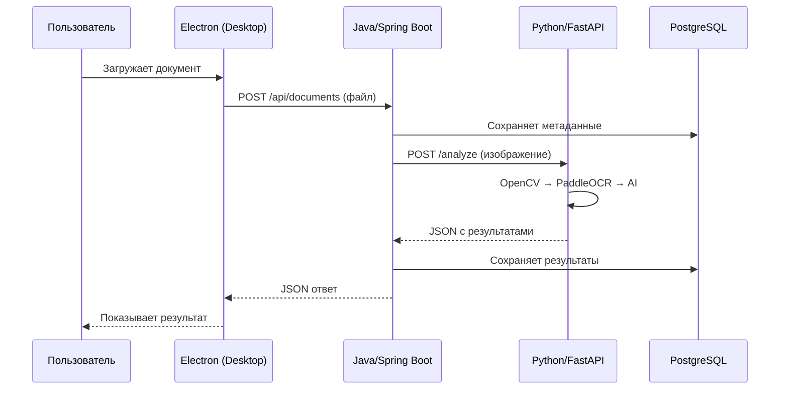
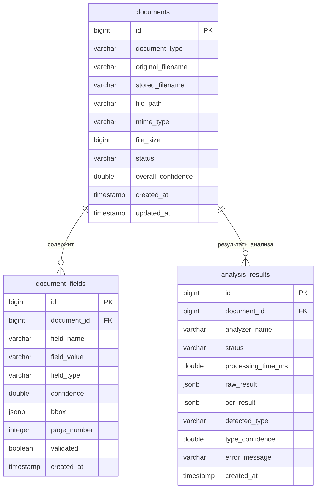

# 📐 Этап 1 — Архитектура и планирование

## 1. Анализ требований

### Что мы строим?

**Document Intelligence** — десктопное приложение, которое:

1. Принимает изображение или PDF документа
2. Автоматически определяет тип документа (паспорт, договор, счёт и т.д.)
3. Распознаёт текст (OCR)
4. Анализирует структуру документа
5. Извлекает ключевые поля (ФИО, дата, сумма, номер и т.д.)
6. Оценивает уверенность каждого результата
7. Сохраняет всё в базу данных
8. Позволяет искать документы и информацию

### Кто участвует в системе?

```
Пользователь → видит интерфейс Electron
Electron     → общается с Java через REST API
Java         → управляет всей бизнес-логикой, хранит данные в PostgreSQL
Python       → выполняет AI-анализ (OCR, классификация, извлечение полей)
PostgreSQL   → хранит структурированные данные
```

---

## 2. Архитектура системы

### Почему именно такая архитектура?

| Компонент | Зачем нужен | Почему именно он |
|-----------|-------------|------------------|
| **Electron** | Desktop UI | Позволяет создать красивое настольное приложение на веб-технологиях (HTML/CSS/JS) |
| **Java/Spring Boot** | Backend API | Зрелая экосистема, строгая типизация, отличная поддержка REST API и БД |
| **Python/FastAPI** | AI-сервис | Python — стандарт для ML/AI, все лучшие библиотеки написаны на Python |
| **PostgreSQL** | База данных | Мощная СУБД с поддержкой JSONB, полнотекстового поиска, надёжная |

### Диаграмма взаимодействия



### Почему Java не делает AI сама?

- ML-библиотеки (PaddleOCR, PyTorch, OpenCV) написаны для Python
- Python имеет гораздо более зрелую ML-экосистему
- Разделение ответственности: Java — бизнес-логика, Python — AI

### Почему Python не работает с БД напрямую?

- Java уже управляет всей бизнес-логикой
- Если Python тоже будет писать в БД — появится два «источника правды»
- Сложнее отлаживать и поддерживать

---

## 3. Структура репозитория

```
document-intelligence/
│
├── electron-app/                    # Desktop-приложение
│   ├── src/
│   │   ├── main/                    # Main process (Node.js)
│   │   │   ├── main.ts              # Точка входа Electron
│   │   │   └── preload.ts           # Preload скрипт (мост)
│   │   └── renderer/                # Renderer process (UI)
│   │       ├── index.html           # Главная HTML-страница
│   │       ├── styles/              # CSS-стили
│   │       │   └── main.css
│   │       ├── scripts/             # JS/TS клиентского кода
│   │       │   ├── app.ts           # Главный модуль UI
│   │       │   ├── api.ts           # HTTP-клиент для Java API
│   │       │   ├── pages/           # Компоненты страниц
│   │       │   │   ├── dashboard.ts
│   │       │   │   ├── upload.ts
│   │       │   │   ├── document.ts
│   │       │   │   ├── search.ts
│   │       │   │   └── settings.ts
│   │       │   └── components/      # Переиспользуемые компоненты
│   │       │       ├── document-card.ts
│   │       │       ├── field-viewer.ts
│   │       │       └── confidence-badge.ts
│   │       └── assets/              # Иконки, изображения
│   ├── package.json
│   ├── tsconfig.json
│   └── forge.config.ts              # Конфигурация сборки
│
├── java-backend/                    # Java backend
│   ├── src/
│   │   ├── main/
│   │   │   ├── java/com/docintell/
│   │   │   │   ├── DocIntelligenceApplication.java  # Точка входа
│   │   │   │   ├── config/                          # Конфигурация
│   │   │   │   │   ├── WebConfig.java               # CORS и т.д.
│   │   │   │   │   └── AppConfig.java               # Общие настройки
│   │   │   │   ├── controller/                      # REST контроллеры
│   │   │   │   │   ├── DocumentController.java
│   │   │   │   │   ├── SearchController.java
│   │   │   │   │   └── StatisticsController.java
│   │   │   │   ├── service/                         # Бизнес-логика
│   │   │   │   │   ├── DocumentService.java
│   │   │   │   │   ├── AnalysisService.java
│   │   │   │   │   ├── SearchService.java
│   │   │   │   │   ├── FileStorageService.java
│   │   │   │   │   └── AiServiceClient.java
│   │   │   │   ├── repository/                      # Доступ к БД
│   │   │   │   │   ├── DocumentRepository.java
│   │   │   │   │   ├── DocumentFieldRepository.java
│   │   │   │   │   └── AnalysisResultRepository.java
│   │   │   │   ├── entity/                          # JPA-сущности
│   │   │   │   │   ├── Document.java
│   │   │   │   │   ├── DocumentField.java
│   │   │   │   │   ├── DocumentFile.java
│   │   │   │   │   └── AnalysisResult.java
│   │   │   │   ├── dto/                             # Объекты передачи данных
│   │   │   │   │   ├── DocumentUploadResponse.java
│   │   │   │   │   ├── DocumentResponse.java
│   │   │   │   │   ├── AnalysisResponse.java
│   │   │   │   │   ├── SearchRequest.java
│   │   │   │   │   ├── SearchResponse.java
│   │   │   │   │   └── StatisticsResponse.java
│   │   │   │   ├── mapper/                          # Entity ↔ DTO
│   │   │   │   │   └── DocumentMapper.java
│   │   │   │   ├── enums/                           # Перечисления
│   │   │   │   │   ├── DocumentType.java
│   │   │   │   │   ├── AnalysisStatus.java
│   │   │   │   │   └── FieldType.java
│   │   │   │   ├── exception/                       # Обработка ошибок
│   │   │   │   │   ├── GlobalExceptionHandler.java
│   │   │   │   │   ├── DocumentNotFoundException.java
│   │   │   │   │   ├── FileValidationException.java
│   │   │   │   │   └── AiServiceUnavailableException.java
│   │   │   │   └── validation/                      # Валидация
│   │   │   │       └── FileValidator.java
│   │   │   └── resources/
│   │   │       ├── application.yml                  # Основная конфигурация
│   │   │       ├── application-dev.yml              # Конфигурация для разработки
│   │   │       └── db/migration/                    # Flyway-миграции БД
│   │   │           ├── V1__create_documents.sql
│   │   │           ├── V2__create_document_fields.sql
│   │   │           └── V3__create_analysis_results.sql
│   │   └── test/
│   │       └── java/com/docintell/
│   │           ├── controller/
│   │           ├── service/
│   │           └── repository/
│   └── pom.xml                                      # Maven зависимости
│
├── ai-service/                      # Python AI-сервис
│   ├── app/
│   │   ├── __init__.py
│   │   ├── main.py                  # Точка входа FastAPI
│   │   ├── config.py                # Настройки
│   │   ├── api/                     # REST endpoints
│   │   │   ├── __init__.py
│   │   │   ├── routes.py            # Маршруты API
│   │   │   └── schemas.py           # Pydantic-модели
│   │   ├── pipeline/                # Главный pipeline обработки
│   │   │   ├── __init__.py
│   │   │   ├── document_pipeline.py # Оркестратор pipeline
│   │   │   └── pipeline_result.py   # Результат pipeline
│   │   ├── preprocessing/           # OpenCV обработка
│   │   │   ├── __init__.py
│   │   │   ├── image_preprocessor.py
│   │   │   ├── quality_checker.py
│   │   │   ├── deskew.py
│   │   │   └── enhancer.py
│   │   ├── ocr/                     # OCR-модуль
│   │   │   ├── __init__.py
│   │   │   ├── ocr_engine.py        # Абстракция OCR
│   │   │   └── paddle_ocr_engine.py # PaddleOCR реализация
│   │   ├── classification/          # Определение типа документа
│   │   │   ├── __init__.py
│   │   │   ├── classifier.py        # Абстракция
│   │   │   └── rule_based_classifier.py
│   │   ├── extraction/              # Извлечение полей
│   │   │   ├── __init__.py
│   │   │   ├── field_extractor.py   # Абстракция
│   │   │   └── pattern_extractor.py # Rule-based извлечение
│   │   ├── analysis/                # Document Understanding
│   │   │   ├── __init__.py
│   │   │   ├── document_analyzer.py # Абстракция
│   │   │   ├── paddle_analyzer.py   # PP-Structure
│   │   │   └── layoutlm_analyzer.py # LayoutLMv3
│   │   ├── confidence/              # Оценка уверенности
│   │   │   ├── __init__.py
│   │   │   └── confidence_scorer.py
│   │   └── validation/              # Валидация полей
│   │       ├── __init__.py
│   │       └── field_validator.py
│   ├── tests/
│   │   ├── test_preprocessing.py
│   │   ├── test_ocr.py
│   │   ├── test_classification.py
│   │   ├── test_extraction.py
│   │   ├── test_confidence.py
│   │   └── test_api.py
│   ├── requirements.txt
│   ├── Dockerfile
│   └── .env.example
│
├── database/                        # Скрипты БД
│   ├── init.sql                     # Начальная инициализация
│   └── migrations/                  # Дополнительные миграции
│
├── dataset/                         # Датасет
│   ├── samples/                     # Примеры документов
│   │   ├── contracts/
│   │   ├── invoices/
│   │   ├── passports/
│   │   ├── certificates/
│   │   └── other/
│   ├── annotations/                 # Разметка
│   ├── train/
│   ├── validation/
│   └── test/
│
├── experiments/                     # Исследования
│   ├── evaluation/
│   │   ├── evaluate_models.py
│   │   ├── generate_distortions.py
│   │   └── compare_results.py
│   ├── results/
│   └── notebooks/
│
├── docker/                          # Dockerfile-ы
│   ├── java-backend.Dockerfile
│   ├── ai-service.Dockerfile
│   └── postgres/
│       └── init.sql
│
├── docs/                            # Документация
│   ├── architecture.md
│   ├── api.md
│   ├── setup.md
│   └── research.md
│
├── docker-compose.yml
├── .env.example
├── .gitignore
└── README.md
```

---

## 4. Схема базы данных

### Таблицы и их назначение



### Объяснение каждой таблицы

#### `documents` — главная таблица

Хранит информацию о каждом загруженном документе:

| Поле | Тип | Зачем |
|------|-----|-------|
| `id` | BIGINT | Уникальный идентификатор документа |
| `document_type` | VARCHAR | Тип: CONTRACT, INVOICE, PASSPORT и т.д. |
| `original_filename` | VARCHAR | Оригинальное имя файла (как назвал пользователь) |
| `stored_filename` | VARCHAR | Имя под которым файл сохранён (UUID, чтобы избежать конфликтов) |
| `file_path` | VARCHAR | Путь к файлу на диске |
| `mime_type` | VARCHAR | MIME-тип: image/jpeg, application/pdf и т.д. |
| `file_size` | BIGINT | Размер файла в байтах |
| `status` | VARCHAR | UPLOADED → PROCESSING → COMPLETED → FAILED |
| `overall_confidence` | DOUBLE | Общая уверенность результата (0.0 — 1.0) |
| `created_at` | TIMESTAMP | Когда документ был загружен |
| `updated_at` | TIMESTAMP | Когда данные обновлялись последний раз |

#### `document_fields` — извлечённые поля

Каждая строка — одно извлечённое поле из документа:

| Поле | Тип | Зачем |
|------|-----|-------|
| `id` | BIGINT | Уникальный ID поля |
| `document_id` | BIGINT FK | Ссылка на документ |
| `field_name` | VARCHAR | Название поля: "number", "date", "amount" |
| `field_value` | VARCHAR | Значение: "123/25", "01.09.2026", "150000" |
| `field_type` | VARCHAR | Тип значения: TEXT, DATE, NUMBER, EMAIL и т.д. |
| `confidence` | DOUBLE | Уверенность в этом поле (0.0 — 1.0) |
| `bbox` | JSONB | Координаты на изображении: `{"x":100,"y":200,"w":400,"h":50}` |
| `page_number` | INTEGER | Номер страницы (для многостраничных PDF) |
| `validated` | BOOLEAN | Подтвердил ли пользователь это значение |

> **Почему JSONB для bbox?** Координаты — это вложенная структура. Создавать 4 отдельных колонки (x, y, w, h) можно, но JSONB удобнее — координаты не нужны для SQL-поиска, они нужны только для отображения.

#### `analysis_results` — результаты анализа

Хранит историю каждого запуска AI-анализа:

| Поле | Тип | Зачем |
|------|-----|-------|
| `analyzer_name` | VARCHAR | Какая модель использовалась: "paddle_ocr", "layoutlm" |
| `processing_time_ms` | DOUBLE | Сколько времени заняла обработка (для сравнения моделей) |
| `raw_result` | JSONB | Полный сырой ответ AI (для отладки и исследований) |
| `ocr_result` | JSONB | Результат OCR со всеми текстовыми блоками |
| `detected_type` | VARCHAR | Какой тип документа определила AI |
| `type_confidence` | DOUBLE | Уверенность в определении типа |

> **Почему `raw_result` хранится как JSONB?** Потому что формат этих данных зависит от модели и может меняться. JSONB позволяет хранить произвольную структуру, не меняя схему таблицы.

---

## 5. API-контракты

### Документы

#### `POST /api/documents` — Загрузка документа

**Зачем:** Пользователь загружает файл в систему.

**Принимает:** `multipart/form-data` с полем `file`

**Возвращает:**
```json
{
  "id": 1,
  "originalFilename": "договор.pdf",
  "documentType": null,
  "status": "UPLOADED",
  "createdAt": "2026-10-12T15:30:00"
}
```

**Ошибки:**
- `400` — неверный формат файла, файл слишком большой
- `500` — ошибка сервера

---

#### `GET /api/documents` — Список документов

**Зачем:** Показать все загруженные документы.

**Параметры (query):**
- `page` — номер страницы (по умолчанию 0)
- `size` — количество на странице (по умолчанию 20)
- `type` — фильтр по типу (необязательно)
- `status` — фильтр по статусу (необязательно)

**Возвращает:**
```json
{
  "content": [
    {
      "id": 1,
      "originalFilename": "договор.pdf",
      "documentType": "CONTRACT",
      "status": "COMPLETED",
      "overallConfidence": 0.94,
      "createdAt": "2026-10-12T15:30:00",
      "fieldsCount": 5
    }
  ],
  "totalElements": 42,
  "totalPages": 3,
  "currentPage": 0
}
```

---

#### `GET /api/documents/{id}` — Детали документа

**Зачем:** Показать полную информацию о документе с полями.

**Возвращает:**
```json
{
  "id": 1,
  "originalFilename": "договор.pdf",
  "documentType": "CONTRACT",
  "status": "COMPLETED",
  "overallConfidence": 0.94,
  "createdAt": "2026-10-12T15:30:00",
  "fields": [
    {
      "id": 1,
      "fieldName": "number",
      "displayName": "Номер договора",
      "fieldValue": "123/25",
      "fieldType": "TEXT",
      "confidence": 0.98,
      "bbox": {"x": 100, "y": 200, "w": 400, "h": 50},
      "pageNumber": 1,
      "validated": false
    },
    {
      "id": 2,
      "fieldName": "date",
      "displayName": "Дата",
      "fieldValue": "01.09.2026",
      "fieldType": "DATE",
      "confidence": 0.96,
      "bbox": {"x": 100, "y": 260, "w": 300, "h": 50},
      "pageNumber": 1,
      "validated": false
    }
  ],
  "analysisResults": [
    {
      "analyzerName": "paddle_ocr",
      "status": "COMPLETED",
      "processingTimeMs": 2340.5,
      "detectedType": "CONTRACT",
      "typeConfidence": 0.91
    }
  ]
}
```

**Ошибки:**
- `404` — документ не найден

---

#### `DELETE /api/documents/{id}` — Удаление документа

**Зачем:** Удалить документ, его поля и файл.

**Ошибки:**
- `404` — документ не найден

---

#### `POST /api/documents/{id}/analyze` — Запуск анализа

**Зачем:** Запустить AI-анализ загруженного документа.

**Принимает (опционально):**
```json
{
  "analyzer": "paddle_ocr",
  "forceReanalyze": false
}
```

**Возвращает:**
```json
{
  "documentId": 1,
  "status": "PROCESSING",
  "message": "Анализ запущен"
}
```

> **Почему анализ отделён от загрузки?** Потому что:
> 1. Загрузка — быстрая операция (секунды)
> 2. AI-анализ — долгая операция (секунды–минуты)
> 3. Пользователь может захотеть перезапустить анализ с другой моделью
> 4. Если AI-сервис временно недоступен — документ всё равно сохранён

---

#### `GET /api/documents/{id}/fields` — Поля документа

**Зачем:** Получить только извлечённые поля (без остальных деталей).

---

#### `POST /api/search` — Поиск документов

**Зачем:** Найти документы по критериям.

**Принимает:**
```json
{
  "query": "ООО Ромашка",
  "documentType": "CONTRACT",
  "dateFrom": "2026-01-01",
  "dateTo": "2026-12-31",
  "minConfidence": 0.8,
  "fieldFilters": [
    {
      "fieldName": "amount",
      "operator": "GT",
      "value": "100000"
    }
  ]
}
```

**Возвращает:** Список документов, соответствующих критериям.

---

#### `GET /api/statistics` — Статистика

**Зачем:** Показать общую статистику для Dashboard.

**Возвращает:**
```json
{
  "totalDocuments": 42,
  "byType": {
    "CONTRACT": 15,
    "INVOICE": 12,
    "PASSPORT": 8,
    "OTHER": 7
  },
  "byStatus": {
    "COMPLETED": 35,
    "PROCESSING": 2,
    "FAILED": 3,
    "UPLOADED": 2
  },
  "averageConfidence": 0.91,
  "lowConfidenceCount": 5,
  "recentDocuments": [...]
}
```

---

### Python AI Service API (внутренний)

> Этот API используется **только** Java-backend, а не Electron напрямую.

#### `POST /analyze` — Полный анализ документа

**Принимает:** `multipart/form-data` с полем `file`

**Возвращает:**
```json
{
  "status": "success",
  "processing_time_ms": 2340.5,
  "document_type": {
    "type": "CONTRACT",
    "confidence": 0.91
  },
  "ocr_results": [
    {
      "text": "ДОГОВОР № 123/25",
      "confidence": 0.98,
      "bbox": [100, 50, 500, 90]
    }
  ],
  "fields": [
    {
      "name": "number",
      "display_name": "Номер договора",
      "value": "123/25",
      "field_type": "TEXT",
      "confidence": 0.97,
      "bbox": [200, 50, 400, 90]
    }
  ],
  "overall_confidence": 0.94
}
```

#### `GET /health` — Проверка доступности

**Возвращает:**
```json
{
  "status": "healthy",
  "models_loaded": true,
  "ocr_ready": true
}
```

---

## 6. План реализации по этапам

```mermaid
flowchart LR
    E1["Этап 1<br/>Архитектура"] --> E2["Этап 2<br/>Прототип<br/>Electron↔Java↔Python"]
    E2 --> E3["Этап 3<br/>PostgreSQL<br/>Сущности, миграции"]
    E3 --> E4["Этап 4<br/>Загрузка файлов"]
    E4 --> E5["Этап 5<br/>AI pipeline<br/>OpenCV + OCR"]
    E5 --> E6["Этап 6<br/>Классификация<br/>документов"]
    E6 --> E7["Этап 7<br/>Извлечение<br/>полей"]
    E7 --> E8["Этап 8<br/>Document<br/>Understanding"]
    E8 --> E9["Этап 9<br/>Confidence<br/>scoring"]
    E9 --> E10["Этап 10<br/>Поиск"]
    E10 --> E11["Этап 11<br/>Полный UI"]
    E11 --> E12["Этап 12<br/>Эксперименты"]
```



| Этап | Что делаем | Результат |
|------|-----------|-----------|
| **1** ✅ | Архитектура | Документ с планом (вы здесь) |
| **2** | Прототип | Electron → Java → Python → ответ → Electron |
| **3** | PostgreSQL | Таблицы, сущности, CRUD |
| **4** | Загрузка | Electron отправляет файл → Java сохраняет |
| **5** | AI pipeline | OpenCV + PaddleOCR = распознанный текст |
| **6** | Классификация | Система определяет тип документа |
| **7** | Извлечение | Из текста извлекаются ключевые поля |
| **8** | Doc Understanding | PP-Structure / LayoutLM для глубокого анализа |
| **9** | Confidence | Расчёт и отображение уверенности |
| **10** | Поиск | Структурированный + natural language поиск |
| **11** | Полный UI | Dashboard, детали документа, подсветка полей |
| **12** | Эксперименты | Сравнение моделей, искажения, метрики |

---

## 7. Важные предупреждения (честные ограничения)

> [!WARNING]
> ### GPU и производительность
> - PaddleOCR работает на CPU, но медленнее чем на GPU
> - LayoutLMv3 требует ~2-4 ГБ RAM для инференса
> - PP-StructureV3 может требовать загрузки моделей (~500 МБ — 2 ГБ)
> - Первый запуск будет медленным (загрузка моделей)

> [!WARNING]
> ### Качество AI
> - Без дообучения модели будут работать «из коробки» — с умеренным качеством
> - Для реальных документов на русском языке может потребоваться fine-tuning
> - Определение типа документа на первых этапах будет rule-based (по ключевым словам)
> - Это нормально для учебного проекта

> [!NOTE]
> ### Зависимости Python
> - PaddlePaddle требует Python 3.8–3.12
> - Некоторые библиотеки могут конфликтовать по версиям
> - Рекомендуется использовать виртуальное окружение (venv)

---

## 8. Следующий шаг

**Этап 2 — Минимальный работающий прототип:**

Создадим простейшую цепочку:

```
Electron (кнопка "Проверить связь")
    ↓ HTTP
Java/Spring Boot (/api/health)
    ↓ HTTP
Python/FastAPI (/health)
    ↓
Ответ: "Все сервисы работают"
    ↓
Electron показывает результат
```

Это докажет, что все три компонента могут общаться друг с другом.
